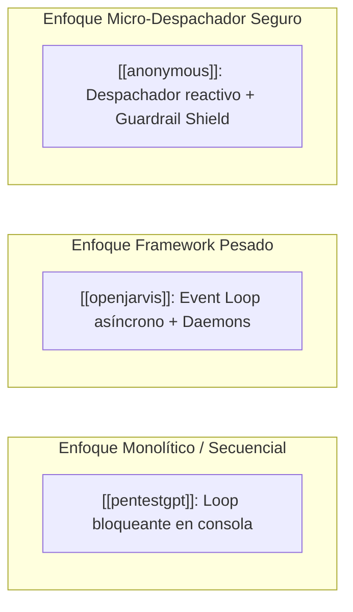

# Comparativa de Runtimes y Motores de Agentes

Este documento analiza cómo maneja cada proyecto el ciclo de vida de la ejecución, la interacción con herramientas y el bucle principal de control (*Agent Loop*).

---

## 1. Los Tres Enfoques de Ejecución

---

## 2. Análisis Detallado por Proyecto

### 1. [[pentestgpt]] (Bucle Replicador de Humano)
* **Mecánica:** Bucle de comandos interactivo con `prompt_toolkit`.
* **Ventaja:** Interfaz muy familiar para auditores de seguridad estilo Metasploit.
* **Limitación:** El ciclo está fuertemente acoplado a la consola de texto; no ofrece una API REST limpia para conectarse a un dashboard web sin reescribir el bucle.

### 2. [[openjarvis]] (Sistema Operativo de Agentes)
* **Mecánica:** Arquitectura dirigida por eventos con soporte asíncrono (`asyncio`), subprocesos, daemons en background y conectores de protocolo MCP.
* **Ventaja:** Máxima capacidad para coordinar múltiples agentes y tareas simultáneas.
* **Limitación:** Mayor complejidad cognitiva y de configuración inicial para pruebas rápidas.

### 3. [[jarvis]] (Asistente Orientado a Eventos de Usuario)
* **Mecánica:** Controladores de eventos de sistema operativo (pulsaciones de teclas globales, capturas de micrófono).
* **Ventaja:** Latencia percibida mínima al dictar o invocar comandos en Windows.
* **Limitación:** Carece de mecanismos nativos para modelar árboles de auditoría o verificar normativas técnicas.

### 4. [[ecc-agents]] (Arnés sin Estado / Gobernanza Pura)
* **Mecánica:** No ejecuta un bucle propio; inyecta directrices deterministas y políticas de ejecución en otros agentes.
* **Ventaja:** Cero consumo de RAM; transforma cualquier modelo en un agente disciplinado y seguro.

### 5. [[anonymous]] (Síntesis Óptima)
* **Mecánica:** Combina la claridad del despachador de OpenJarvis con el clasificador de riesgo de ECC y la estructura de fases de PentestGPT.
* **Resultado:** Un único punto de entrada (`process_input()`) que atiende indistintamente a la terminal Warp o a peticiones HTTP del navegador, manteniendo siempre el estado sincronizado en SQLite.

---

## 3. Enlaces Relacionados
* [[architecture-matrix]] - Comparativa general del sistema.
* [[openjarvis]] - El framework de referencia.
* [[anonymous]] - Implementación del micro-despachador unificado.
