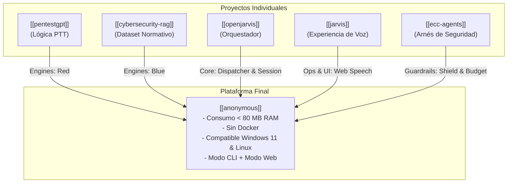

# Matriz Comparativa de Arquitectura del Ecosistema

Esta tabla resume las especificaciones técnicas, dependencias y roles de cada proyecto dentro del ecosistema `anonimus`, ilustrando cómo convergen en la plataforma [[anonymous]].

---

## 1. Matriz de Características Técnicas

| Proyecto | Rol Principal | Interfaz | Persistencia / Memoria | Consumo Estimado de RAM | Dependencia de Docker | Módulo Clave Reutilizado |
| :--- | :--- | :--- | :--- | :--- | :--- | :--- |
| **[[pentestgpt]]** | Auditoría Ofensiva (Red Team) | Terminal CLI (`prompt_toolkit`) | Archivos JSON en disco | ~80 - 150 MB | Opcional | Árbol de Tareas [[ptt-task-tree]] |
| **[[cybersecurity-rag]]** | Consultor Defensivo (Blue Team) | API FastAPI | ChromaDB en disco | ~300 - 600 MB (por embeddings locales) | En su repo original sí | Base de normativas (OWASP, MITRE, CIS) |
| **[[openjarvis]]** | Orquestador Asíncrono | CLI / Web / Daemon | SQLite / JSON | ~120 - 250 MB | No | Despachador central y sesiones |
| **[[jarvis]]** | Asistente de Escritorio y Voz | System Tray + Atajos Globales | Configuración local | ~500 MB - 1.2 GB (si usa Whisper local) | No | Atajos de teclado e integración de voz |
| **[[ecc-agents]]** | Arnés de Seguridad & Reglas | Terminal / Hooks | Archivos Markdown | 0 MB (recursos estáticos) | No | Filtro [[agentshield-hitl]] y [[context-budgeting]] |
| **[[anonymous]]** | **Plataforma Híbrida Unificada** | **Dual: Warp CLI + Web GUI** | **SQLite (`anonymous.db`)** | **~45 - 80 MB (Ultra-optimizado)** | **NO (100% Nativo)** | **Ensamblaje unificado de todos los anteriores** |

---

## 2. Mapa de Fusión hacia Anonymous

---

## 3. Resoluciones Clave de Diseño y Tradeoffs

1. **Eliminación de Docker:**  
   Se reemplazaron las dependencias de Docker por la capa agnóstica [[multiplatform-os]], ahorrando entre 2.0 y 3.5 GB de RAM.
2. **Reemplazo de ChromaDB por Búsqueda Semántica Ligera:**  
   Se eliminó la carga en frío de modelos locales pesados de PyTorch/SentenceTransformers, logrando arranques instantáneos de milisegundos en [[anonymous]].
3. **Voz vía Web Speech API:**  
   En vez de instanciar Whisper en local (que saturaría la memoria de la GPU/CPU integrada AMD), se utiliza el motor de voz del navegador en la GUI web.

---

## 4. Enlaces Relacionados
* [[anonymous]] - Arquitectura del sistema unificado.
* [[agent-runtimes]] - Comparativa detallada de runtimes.
* [[rag-vs-wiki]] - Consideraciones sobre almacenamiento de conocimiento.
