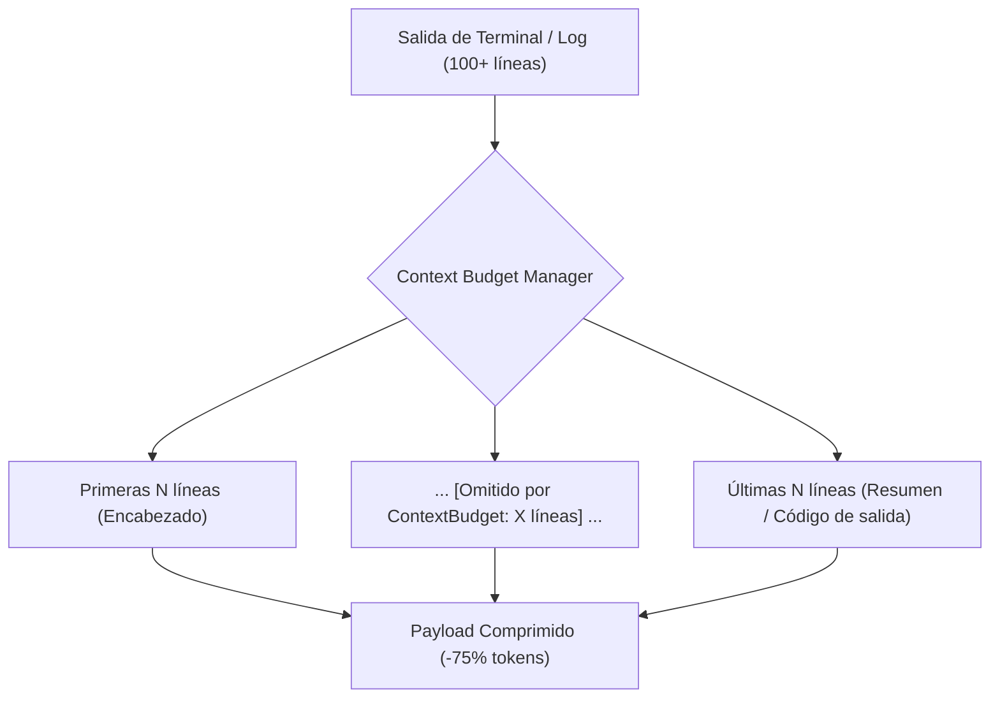

# Presupuesto y Compresión de Contexto (Context Budgeting)

> **Inspirado en:** Habilidad `context-budget` de [[ecc-agents]] y aplicado en [[anonymous]].

---

## 1. El Problema del Hinchamiento de Contexto (*Context Bloat*)

A medida que una conversación con un agente técnico progresa:
* Se ejecutan escaneos de red, se leen archivos de código y se devuelven logs extensos de terminal.
* El historial acumulado satura la ventana de contexto.
* **Consecuencias:**
  1. **Degradación del razonamiento:** Los LLMs sufren del fenómeno *Lost in the Middle* (olvidan instrucciones iniciales o confunden datos entre miles de líneas irrelevantes).
  2. **Latencia incrementada:** Respuestas significativamente más lentas.
  3. **Agotamiento de cuotas gratuitas:** Consumo acelerado del límite por minuto de la API.

---

## 2. Estrategias de Compresión de Contexto

1. **Poda Progresiva de Mensajes (*Turn Pruning*):**  
   Mantener intactas las directrices del sistema (`system_instruction`) y conservar solo los últimos 6 a 10 turnos de interacción activa, descartando charlas efímeras ya resueltas.
2. **Compresión Bipartita de Salidas de Consola (*Head-and-Tail Truncation*):**  
   Cuando un escáner o compilador genera 500 líneas, el LLM solo necesita ver el inicio (argumentos y objetivo) y el final (resultado y errores). El cuerpo repetitivo se poda.
3. **Persistencia Externa:**  
   En lugar de mantener en la memoria viva del LLM todos los hallazgos pasados, se archivan en SQLite (`anonymous.db`) o en la [[rag-vs-wiki|LLM Wiki]], recuperándolos solo bajo demanda.

---

## 3. Implementación en [[anonymous]]

El módulo `anonymous/guardrails/context_budget.py` implementa:
* `estimate_tokens(text)`: Estimación rápida de consumo sin dependencias de tokenizadores pesados.
* `prune_history(history)`: Selección automática de turnos críticos.
* `compress_tool_output(output)`: Reducción automática de salidas extensas de comandos de red.

---

## 4. Enlaces Relacionados
* [[ecc-agents]] - Origen de la técnica de context-budgeting.
* [[anonymous]] - Arquitectura donde protege el consumo de Gemini Flash.
* [[rag-vs-wiki]] - La Wiki como almacén que alivia el contexto del chat.
