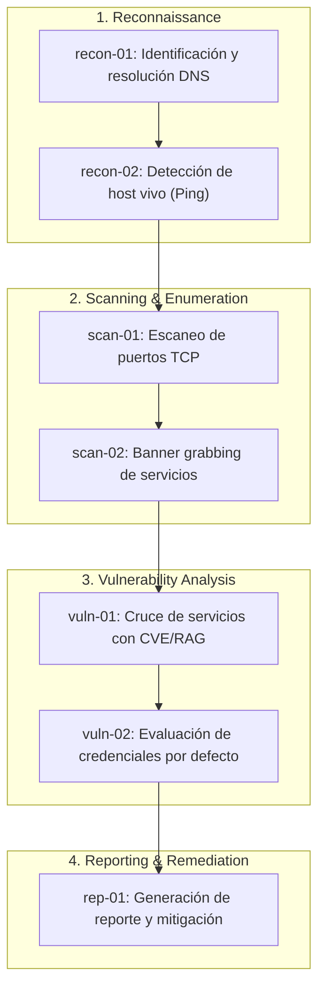

# Pentesting Task Tree (PTT) - Metodología de Árbol de Tareas

> **Implementado en:** [[pentestgpt]] y adaptado en [[anonymous]].

---

## 1. ¿Qué es el Pentesting Task Tree?

El **Pentesting Task Tree (PTT)** es una estructura jerárquica de datos y toma de decisiones que modela el razonamiento de un auditor de seguridad durante una prueba de penetración.

A diferencia de una lista plana de tareas pendientes (*To-Do list*), el PTT:
1. **Es dependiente del contexto:** Una fase solo se desbloquea o refina cuando las subtareas de la fase anterior han producido resultados (ej: no se buscan vulnerabilidades en un puerto que no está verificado como abierto).
2. **Gestiona estados dinámicos:** Cada nodo puede estar en estado `pending`, `in_progress`, `completed` o `failed`.
3. **Mantiene el foco del LLM:** Evita que el agente se desvíe o intente fases avanzadas (como exploits) sin haber completado el reconocimiento básico.

---

## 2. Diagrama de Fases del PTT

---

## 3. Implementación en [[anonymous]]

En `anonymous/engines/red/ptt.py`, el árbol está respaldado por SQLite:
* Cuando el usuario ejecuta un escaneo de puertos (`scan 127.0.0.1`), el motor actualiza de forma autónoma el estado de `scan-01` a `completed`, registrando cuántos puertos abiertos se encontraron.
* Esto permite que tanto la interfaz CLI en terminal como el Dashboard Web reflejen visualmente el avance del pentest en tiempo real.

---

## 4. Enlaces Relacionados
* [[pentestgpt]] - Proyecto donde se originó el PTT.
* [[anonymous]] - Implementación nativa y reactiva del árbol.
* [[agentshield-hitl]] - Barrera de control antes de avanzar a fases de alto riesgo.
