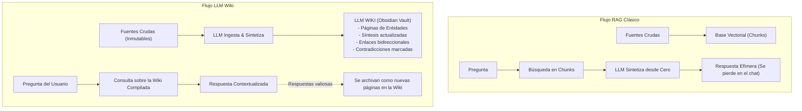

# RAG Tradicional vs LLM Wiki Persistente

> **Concepto clave:** Por qué una Wiki mantenida por un LLM supera las limitaciones del RAG convencional para acumulación de conocimiento a largo plazo.

---

## 1. La Limitación Fundamental del RAG Tradicional

En los sistemas habituales como [[cybersecurity-rag]], NotebookLM o ChatGPT con carga de archivos:
* Se divide un conjunto de documentos en miles de fragmentos (*chunks*).
* Cuando el usuario hace una pregunta, se buscan los 3 o 5 fragmentos más similares por distancia vectorial y se envían al modelo.
* **El problema:** El LLM redescubre el conocimiento **desde cero en cada consulta**. No existe acumulación. Si una pregunta sutil requiere sintetizar cinco fuentes distintas o detectar contradicciones entre ellas, el sistema debe fragmentar y ensamblar la información cada vez. Nada queda construido de forma persistente.

---

## 2. El Paradigma de la "LLM Wiki"

La **LLM Wiki** propone una capa intermedia estructurada y acumulativa entre las fuentes originales y el usuario:

---

## 3. Comparación Directa de Propiedades

| Dimensión | RAG Clásico (ej. [[cybersecurity-rag]]) | LLM Wiki (ej. esta Wiki en Obsidian) |
| :--- | :--- | :--- |
| **Persistencia del conocimiento** | No hay acumulación; se evalúa por turno. | **Compilación persistente e incremental.** |
| **Relaciones entre conceptos** | Fragmentos aislados por similitud coseno. | **Enlaces asociativos explícitos (`[[...]]`).** |
| **Manejo de contradicciones** | Difícil de detectar entre chunks no coincidentes. | **Señala explícitamente en el texto discrepancias.** |
| **Mantenimiento** | Re-vectorización costosa. | **El LLM edita y cruza páginas automáticamente.** |
| **Exploración Humana** | Caja negra (vector store inescrutable). | **Navegable en Obsidian con panel de grafos (*Graph View*).** |

---

## 4. Convivencia Sinergética en [[anonymous]]

En [[anonymous]], ambos patrones no compiten, sino que se potencian:
1. **RAG en caliente:** Para consultar de inmediato normativas técnicas puntuales o directrices de OWASP cuando surge un puerto nuevo en un escaneo.
2. **LLM Wiki en frío:** Para registrar hallazgos de auditorías, arquitecturas de proyectos y el historial evolutivo del sistema de forma navegable y duradera.

---

## 5. Enlaces Relacionados
* [[cybersecurity-rag]] - Implementación clásica de RAG.
* [[anonymous]] - Plataforma híbrida.
* [[context-budgeting]] - Cómo la wiki ayuda a preservar tokens.
