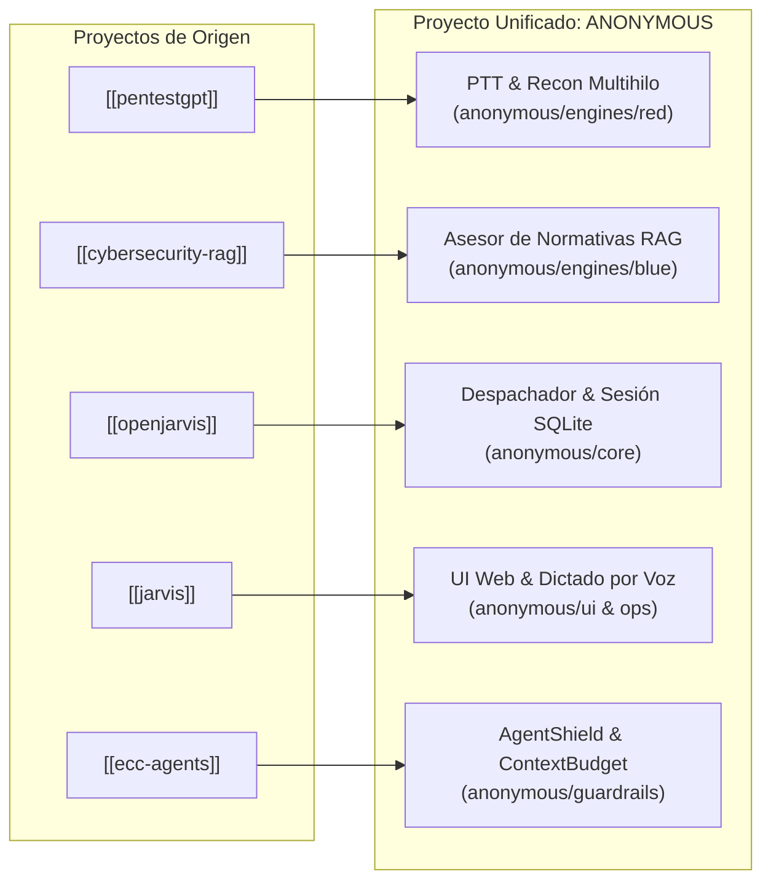

# Anonymous - Plataforma Unificada de Ciberseguridad Híbrida

> **Ubicación:** [`anonymous`](file:///C:/Users/maxgu/Documents/anonimus/anonymous)  
> **Rol en el ecosistema:** Proyecto central que ensambla, consolida y optimiza los mejores módulos de [[pentestgpt]], [[cybersecurity-rag]], [[openjarvis]], [[jarvis]] y [[ecc-agents]].

---

## 1. Visión General y Propósito

**Anonymous** nace de la necesidad de contar con una herramienta completa de ciberseguridad (Red Team + Blue Team + Asistente) que sea:
1. **100% Nativa y Ligera:** Capaz de correr con fluidez en una máquina con procesador AMD Ryzen 5 y **8 GB de RAM**, **sin necesidad de Docker**.
2. **Multiplataforma Real:** Funciona de forma idéntica en Windows 11 (PowerShell/CMD) y en Linux (Bash/Zsh) mediante una capa de abstracción ([[multiplatform-os]]).
3. **Híbrida Dual:** Ofrece modo terminal rápido en Warp (`python run.py`) y un dashboard visual interactivo bajo demanda (`python run.py --gui`).

---

## 2. Mapa de Fusión: De Dónde Proviene Cada Componente



---

## 3. Arquitectura del Código

* `run.py`: Punto de entrada universal para lanzar en modo CLI o GUI (`--gui`).
* `anonymous/core/`:
  * `os_adapter.py`: Traduce comandos de red y detecta el sistema operativo ([[multiplatform-os]]).
  * `dispatcher.py`: Enrutador central que valida la intención del usuario.
  * `session.py`: Base de datos SQLite para persistir el historial, los hallazgos y las fases PTT.
* `anonymous/guardrails/`:
  * `agent_shield.py`: Filtro [[agentshield-hitl]] de confirmación humana para comandos peligrosos o escaneos remotos.
  * `context_budget.py`: Gestor de compresión de contexto ([[context-budgeting]]).
* `anonymous/brain/`:
  * `gemini_client.py`: Conector directo a la API gratuita de Google Gemini Flash con modo local de respaldo automático.
* `anonymous/engines/`:
  * `red/`: Motor ofensivo con escáner de sockets TCP nativo y [[ptt-task-tree]].
  * `blue/`: Motor defensivo con conocimiento de OWASP, MITRE ATT&CK y CIS Controls.
  * `ops/`: Monitoreo de salud del sistema, briefing diario y hooks de voz.
* `anonymous/ui/`:
  * `cli.py`: Interfaz visual en terminal construida con la librería `rich`.
  * `server.py` + `web/`: Servidor HTTP ligero con panel de control oscuro, chat, visualizador PTT y reconocimiento por voz en el navegador.

---

## 4. Modos de Ejecución

### Modo 1: Terminal (Warp / CLI)
```bash
python run.py
```
Permite auditar redes, visualizar árboles de tareas y consultar normativas directamente desde la línea de comandos con consumo de memoria inferior a 60 MB.

### Modo 2: Panel Gráfico Web (GUI)
```bash
python run.py --gui
```
Levanta el servidor local en `http://127.0.0.1:7860` con sincronización en tiempo real del estado de tareas y hallazgos.

---

## 5. Enlaces Relacionados
* [[pentestgpt]] - Origen de la lógica ofensiva PTT.
* [[cybersecurity-rag]] - Origen del conocimiento normativo.
* [[openjarvis]] - Origen del modelo de despacho y sesiones.
* [[ecc-agents]] - Origen de los filtros de contención de seguridad.
* [[architecture-matrix]] - Matriz comparativa de especificaciones.
