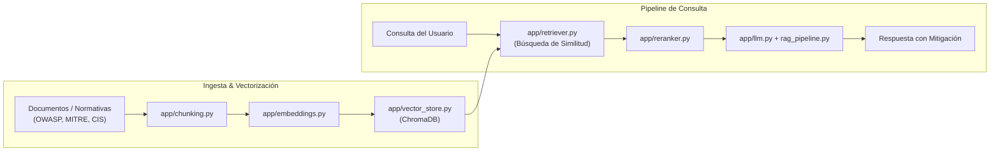

# Cybersecurity RAG Assistant - Motor Defensivo y Normativo

> **Fuente original:** [`cybersecurity-rag-assistant-main`](file:///C:/Users/maxgu/Documents/anonimus/cybersecurity-rag-assistant-main)  
> **Rol en el ecosistema:** Aporta la inteligencia defensiva (Blue Team), la consulta sobre normativas de seguridad (OWASP, MITRE ATT&CK, CIS Controls) y la generación de recomendaciones de mitigación.

---

## 1. Visión General y Propósito

Este proyecto implementa un asistente de consulta técnica y defensiva basado en la arquitectura **RAG (Retrieval-Augmented Generation)**. Permite al operador consultar dudas sobre vectores de ataque, configuraciones seguras y normativas oficiales, devolviendo respuestas fundamentadas con citas directas.

---

## 2. Arquitectura Interna

### Componentes Clave:
* `app/main.py`: API ligera construida sobre FastAPI con endpoints `/ask` y `/evaluate`.
* `app/vector_store.py`: Abstracción de base de datos vectorial local basada en ChromaDB.
* `app/retriever.py` & `app/reranker.py`: Mecanismo híbrido para filtrar fragmentos relevantes y reordenarlos por relevancia contextual.
* `evaluation/`: Suite de métricas para evaluar la precisión y alucinación del sistema RAG.

---

## 3. Normativas y Bases de Conocimiento Soportadas

1. **OWASP Top 10 (Web Security):**  
   Pérdida de control de acceso, inyecciones (SQL/Comandos), fallos criptográficos, desconfiguraciones de seguridad.
2. **MITRE ATT&CK Enterprise:**  
   Catálogo de tácticas, técnicas y procedimientos (TTPs) usados por adversarios (ej. T1046 Network Service Discovery, T1078 Valid Accounts).
3. **CIS Controls v8:**  
   Controles prioritarios de endurecimiento (*hardening*) de sistemas y gestión de identidades.

---

## 4. Análisis Crítico: RAG vs LLM Wiki

Como se discute en [[rag-vs-wiki]], este proyecto representa el enfoque clásico de RAG:
* **Ventaja:** Permite indexar miles de páginas de PDFs o normativas complejas en disco.
* **Limitación tradicional:** Redescubre fragmentos desde cero en cada llamada sin acumular síntesis entre sesiones.

---

## 5. Integración en [[anonymous]]

Para optimizar el rendimiento en una máquina con 8 GB de RAM y evitar las dependencias pesadas de ChromaDB y modelos locales de embeddings:
1. **Base de Conocimiento Curada**: Se integraron los datos más críticos de OWASP, MITRE y CIS directamente en `anonymous/engines/blue/knowledge_base.py`.
2. **Motor de Recuperación Ultrarrápido**: `anonymous/engines/blue/rag_engine.py` utiliza búsqueda por términos ponderados y similitud léxica sin consumo adicional de memoria RAM.
3. **Sinergia con Red Team**: Cuando [[pentestgpt]] detecta un puerto abierto (ej: 445 SMB), el motor Blue Team consulta automáticamente las guías de mitigación correspondientes.

---

## 6. Enlaces Relacionados
* [[rag-vs-wiki]] - Comparación teórica entre RAG en tiempo real y Wikis persistentes.
* [[anonymous]] - Plataforma unificada donde opera como motor defensivo.
* [[architecture-matrix]] - Matriz de componentes y roles.
