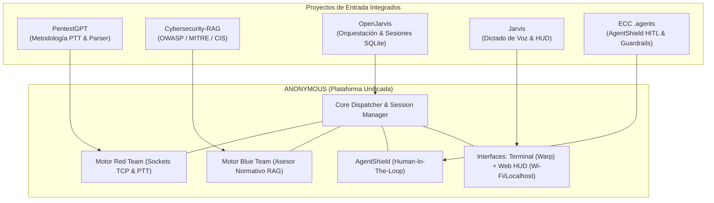
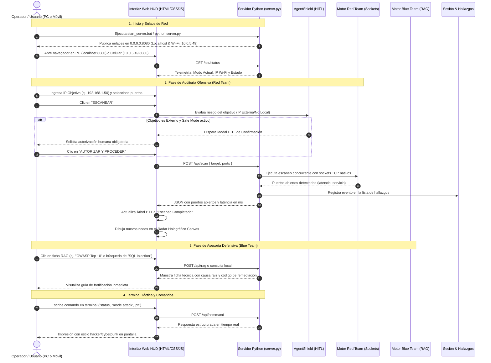

# Documentación Integral del Proyecto Anonymous

> **Ubicación del Código Principal:** [`anonymous/`](file:///C:/Users/maxgu/Documents/anonimus/anonymous)  
> **Ubicación del Boceto y Servidor Web:** [`pagina/`](file:///C:/Users/maxgu/Documents/anonimus/pagina)  
> **Servidor Local / Transmisión Wi-Fi:** `http://localhost:8080` | `http://10.0.5.49:8080` (0.0.0.0:8080)

---

## 1. Contexto Detallado del Proyecto Anonymous e Ideas Fundamentales

### 1.1 Origen y Génesis del Proyecto
El proyecto **Anonymous** surge como una respuesta de ingeniería avanzada frente a la dispersión de herramientas en el campo de la seguridad informática y la inteligencia artificial aplicada. En lugar de construir un software aislado, Anonymous representa la **fusión, ensamblado y optimización sinérgica** de cinco repositorios y frameworks de vanguardia:

1. **[[projects/pentestgpt|PentestGPT]]:** Motor de auditoría ofensiva (*Red Team*) estructurado sobre la metodología de [[concepts/ptt-task-tree|Árbol de Tareas de Pentesting (PTT)]], permitiendo descomponer una intrusión ética en fases dependientes (Reconocimiento, Escaneo, Enumeración, Explotación y Reporte).
2. **[[projects/cybersecurity-rag|Cybersecurity-RAG]]:** Base de conocimiento y motor de recuperación defensiva (*Blue Team*) enfocado en los tres pilares de gobernanza: **OWASP Top 10** (seguridad de aplicaciones web), **MITRE ATT&CK** (tácticas, técnicas y procedimientos de adversarios) y **CIS Controls v8** (buenas prácticas de configuración y endurecimiento).
3. **[[projects/openjarvis|OpenJarvis]]:** Orquestador asíncrono para gestión de agentes, persistencia de sesiones en base de datos SQLite y soporte para integración de herramientas con el protocolo MCP (*Model Context Protocol*).
4. **[[projects/jarvis|Jarvis]]:** Interfaz de asistente de escritorio de alta respuesta con capacidades de dictado por voz, notificaciones de eventos y diseño HUD táctico.
5. **[[projects/ecc-agents|ECC (.agents)]]:** Arnés de gobernanza ética y contención de seguridad, origen del sistema **[[concepts/agentshield-hitl|AgentShield]]** con supervisión humana obligatoria (*Human-In-The-Loop*) y presupuesto estricto de contexto ([[concepts/context-budgeting|Context Budgeting]]).



---

### 1.2 Principios de Ingeniería e Ideas Clave

#### A. Regla Estricta "No Docker" y Optimización de Recursos (Target: 8 GB RAM)
Uno de los problemas más críticos en herramientas de pentesting modernas es su dependencia forzada de contenedores Docker o máquinas virtuales completas (como Kali Linux en VirtualBox o WSL2). 
* **El problema de Docker en equipos estándar:** Levantar WSL2 con Docker Desktop en una laptop convencional con procesador AMD Ryzen 5 y 8 GB de RAM consume de 3.5 a 4 GB solo para inicializar el subsistema Linux, congelando el entorno operativo del usuario.
* **La solución de Anonymous:** Ejecución **100% nativa en Python sin Docker** ([[concepts/multiplatform-os]]). El escáner de red está programado directamente sobre la biblioteca nativa `socket` del sistema operativo; las sesiones persisten en SQLite embebido; y la memoria total del asistente se mantiene en **menos de 60 MB en modo CLI** y **menos de 100 MB con el servidor táctico web activo**.

#### B. Arquitectura Híbrida Dual (Terminal + Dashboard Web Táctico)
Anonymous no obliga al usuario a elegir entre consola o interfaz gráfica:
1. **Modo CLI (Warp / Terminal):** Se ejecuta con `python run.py`. Diseñado para analistas experimentados que prefieren velocidad bruta, manipulación de tuberías (*pipes*) y atajos de teclado con renderizado `rich`.
2. **Modo Web HUD Táctico (`pagina/`):** Se ejecuta con `python server.py --port 8080` (o `start_server.bat`). Proporciona una interfaz visual interactiva tipo Stark Industries HUD con paletas intercambiables (Normal, Ataque Red Team, Defensa Blue Team, Éxito, Error), radar holográfico interactivo en HTML5 Canvas y consola interactiva.

#### C. Transmisión Abierta por Wi-Fi y Localhost
El servidor web de Anonymous está diseñado para enlazar la dirección de comodín `0.0.0.0:8080`, lo que significa que el panel de control:
* Es accesible localmente desde la propia máquina en `http://localhost:8080`.
* Se transmite inmediatamente a cualquier dispositivo en la misma red local Wi-Fi (como teléfonos móviles, tablets u otras laptops) mediante la dirección IP local asignada (ejemplo: `http://10.0.5.49:8080`). Esto permite auditar un laboratorio o controlar el escaneo de forma remota y móvil sin requerir cables ni software adicional.

---

## 2. ¿Qué Problema Resuelve su Programa en el Mundo Real?

### 2.1 La Fragmentación del Ecosistema de Seguridad
En una auditoría de seguridad convencional, los analistas deben utilizar múltiples herramientas incompatibles entre sí:
* Un escáner de puertos (Nmap o scripts en terminal).
* Un editor de texto para registrar notas y bitácoras del árbol de tareas.
* Sitios web dispersos para buscar vulnerabilidades en OWASP o tácticas en MITRE ATT&CK.
* Módulos adicionales para generar el reporte de cierre.

> [!IMPORTANT]
> **Solución de Anonymous:** Centraliza todo el ciclo de vida de la auditoría en un único panel: el usuario ejecuta el escaneo de sockets, los puertos abiertos se reflejan automáticamente en el Árbol PTT, las normativas de mitigación se consultan en el asesor RAG en tiempo real, y los eventos quedan registrados en la base de datos de hallazgos.

---

### 2.2 Eliminación de la Barrera de Entrada de Hardware
Muchas empresas pequeñas, estudiantes universitarios y profesionales independientes no cuentan con estaciones de trabajo con 32 o 64 GB de RAM.
* Anonymous democratiza el aprendizaje y la práctica de auditorías de ciberseguridad, permitiendo que cualquier equipo estándar con Windows 11 o Linux corra auditorías de sockets y consultas de IA sin sobrecalentar el procesador ni saturar la memoria RAM.

---

### 2.3 Contención Ética y Prevención de Daños (AgentShield HITL)
La integración de modelos de lenguaje e inteligencia artificial en ciberseguridad conlleva un peligro real: los agentes autónomos pueden tomar decisiones imprevistas, enviar tráfico masivo a servidores gubernamentales o de terceros, o ejecutar comandos que dañen la disponibilidad de los servicios.

> [!CAUTION]
> **El Riesgo en el Mundo Real:** Un script autónomo de IA al que se le pide "probar la red" podría atacar la pasarela de pago o el router perimetral de una empresa sin autorización legal.

* **Solución de Anonymous con AgentShield:** Introduce una barrera infranqueable de **Human-In-The-Loop (HITL)**. Todo comando categorizado como sensible (escaneos a rangos que no sean localhost, pruebas intrusivas o cambios de configuración) activa una alerta de confirmación con modal interactivo. La orden queda en suspenso hasta que el operador humano la autorice expresamente.

---

### 2.4 Puente Inmediato entre el Ataque (Red) y la Mitigación (Blue)
Generalmente existe una brecha entre los auditores que encuentran la falla y los ingenieros encargados de parcharla.
* En Anonymous, cuando el motor Red Team detecta por ejemplo el puerto `8080` o `3306`, el analista tiene a un solo clic las directrices de remediación de `OWASP A01:2021 (Control de Acceso Roto)` y `A05:2021 (Mala Configuración)`, indicando exactamente qué cabeceras HTTP agregar, cómo configurar el cortafuegos y qué buenas prácticas de CIS Controls aplicar.

---

## 3. ¿Cómo Interactúa el Usuario con la Aplicación? (Flujo Detallado)

### 3.1 Diagrama de Flujo de Interacción del Usuario



---

### 3.2 Pasos Detallados del Flujo Operativo

#### Paso 1: Lanzamiento del Servidor y Detección de IP
1. El usuario inicia el servidor ejecutando `start_server.bat` o el comando:
   ```powershell
   cd C:\Users\maxgu\Documents\anonimus\pagina
   python server.py --port 8080
   ```
2. El servidor detecta automáticamente la interfaz de red activa y la IP asignada por la red Wi-Fi (en este equipo: `10.0.5.49`).
3. El banner informativo expone las dos URLs disponibles:
   * **URL Local:** `http://localhost:8080`
   * **URL Wi-Fi para dispositivos móviles:** `http://10.0.5.49:8080`

#### Paso 2: Conexión desde el Navegador (Escritorio o Smartphone)
1. Al acceder a la página web, el cliente JavaScript se comunica con `/api/status`.
2. Se sincronizan en milisegundos las métricas de hardware, el reloj UTC y el estado del radar holográfico.
3. El usuario puede pulsar el botón **[COPIAR]** en el chip de Wi-Fi de la cabecera para compartir la dirección fácilmente con otros colegas en el mismo laboratorio o aula.

#### Paso 3: Selección de Modo de Operación
El usuario cuenta con cinco modos tácticos seleccionables en la barra superior o mediante el comando `mode <nombre>` en la terminal:
* **Modo Normal (Cyan):** Monitoreo pasivo y exploración de la base de conocimiento.
* **Modo Ataque / Red Team (Púrpura Neón):** Habilita las rutinas ofensivas del árbol PTT y preparación de sockets.
* **Modo Defensa / Blue Team (Verde Esmeralda):** Enfoque en normativas OWASP, MITRE y cumplimiento.
* **Modo Éxito (Lima):** Estado visual al concluir auditorías satisfactoriamente.
* **Modo Error (Carmesí):** Alerta ante anomalías o caídas de conexión.

#### Paso 4: Ejecución del Escaneo y Supervisión AgentShield
1. En el panel izquierdo, el usuario define la IP objetivo (por defecto `127.0.0.1`) y activa o desactiva los puertos deseados (`21, 22, 80, 443, 3306, 5000, 7860, 8080`).
2. Al presionar **ESCANEAR**:
   * Si la IP es local (`127.0.0.1` o `localhost`), el escaneo se dispara inmediatamente.
   * Si la IP apunta a una subred externa y el switch **HITL Forzado** está encendido, se despliega el **Modal de Seguridad AgentShield** exigiendo la confirmación explícita del operador antes de emitir ningún paquete de red.
3. El motor de sockets prueba los puertos en paralelo y retorna los resultados en menos de 0.5 segundos.
4. Cada puerto abierto genera un hallazgo con etiqueta de severidad y aparece como un nodo brillante en el radar holográfico central.
5. El Árbol PTT marca automáticamente la fase `T2 - Escaneo` como **COMPLETADO** y activa la siguiente fase `T3 - Enumeración`.

#### Paso 5: Consulta Normativa RAG y Remediación
1. En el panel derecho, el usuario puede filtrar por categorías (`OWASP Top 10`, `MITRE ATT&CK`, `CIS Controls`) o ingresar un término de búsqueda (ej. `acceso`, `inyección`, `discovery`).
2. El sistema devuelve tarjetas con:
   * Identificador formal (ej. `A01:2021`, `T1046`).
   * Descripción concisa de la amenaza.
   * Recomendación concreta de mitigación defensiva (*Hardening*).

#### Paso 6: Terminal Interactiva en Tiempo Real
El usuario dispone de una consola tipo Unix en el centro inferior que admite comandos escritos:
* `status` / `estado`: Muestra la telemetría del servidor, IP Wi-Fi y puertos.
* `scan <ip>`: Ejecuta un escaneo directo desde la línea de comandos.
* `ping <host>`: Mide la latencia de respuesta de un socket.
* `rag <consulta>`: Busca normativas directamente desde la terminal.
* `ptt`: Imprime el estado jerárquico del árbol PTT.
* `findings`: Lista los eventos registrados en la sesión.
* `mode <attack|defense|normal>`: Cambia el tema visual en vivo.
* `clear`: Limpia la pantalla de la terminal.

---

## 4. Estructura de Archivos del Módulo `pagina`

```text
pagina/
├── index.html         # Maqueta y boceto táctico interactivo (HTML5 semántico)
├── styles.css         # Estilos Glassmorphic HUD Stark con soporte multitema
├── app.js             # Lógica cliente, radar Canvas 3D a 60 FPS y terminal
├── server.py          # Servidor HTTP Python nativo (0.0.0.0:8080 con Wi-Fi)
├── start_server.bat   # Lanzador directo para Windows con doble clic
└── README.md          # Manual de uso y configuración rápida
```

---

## 5. Enlaces y Referencias en la Wiki

* [[projects/anonymous|Página Principal de Anonymous]]
* [[concepts/ptt-task-tree|Metodología del Árbol de Tareas PTT]]
* [[concepts/agentshield-hitl|Arnés de Seguridad AgentShield & HITL]]
* [[concepts/multiplatform-os|Arquitectura Multiplataforma Nativa Sin Docker]]
* [[comparisons/architecture-matrix|Matriz Comparativa de Arquitectura]]
