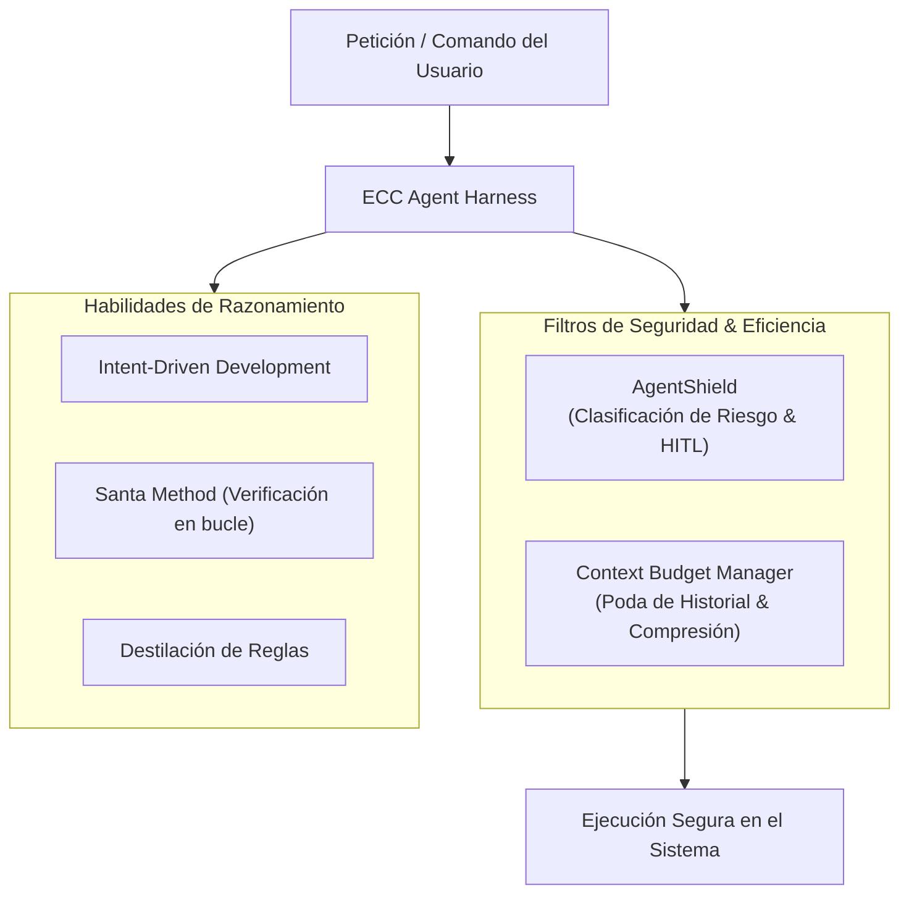

# ECC (.agents) - Arnés de Seguridad, Habilidades y Rendimiento

> **Fuente original:** [`.agents` (ECC - affaan-m/ECC)](file:///C:/Users/maxgu/Documents/anonimus/.agents)  
> **Rol en el ecosistema:** Proporciona el arnés de contención de seguridad (AgentShield), el control de presupuesto de tokens (*context-budget*) y la suite de metodologías de ingeniería para agentes de IA.

---

## 1. Visión General y Propósito

ECC es un arnés de alto rendimiento para agentes de IA. No es un programa ejecutable tradicional, sino una **infraestructura de gobierno de agentes** que incluye:
* **Reglas estrictas de codificación** para múltiples lenguajes (Python, Rust, React, TypeScript).
* **Guardián de seguridad (AgentShield)** para evitar comandos de terminal destructivos o peligrosos.
* **Técnicas de optimización de contexto (Context Budget)** para que las llamadas a APIs de LLMs no crezcan sin control.

---

## 2. Arquitectura Interna

### Componentes Clave:
* `.agents/skills/context-budget/`: Guía y algoritmos para podar historiales de chat y resumir salidas de terminal para reducir el consumo de tokens en un 70%.
* `.agents/rules/*-security.md`: Reglas de seguridad defensiva para desarrollo de software.
* `.agents/workflows/`: Flujos de trabajo estandarizados de revisión, pruebas y aprobación humana obligatoria (*Human-In-The-Loop*).

---

## 3. ¿Por qué es Vital para un Asistente de Pentesting?

Un agente con acceso a la terminal y capacidades de red (como [[pentestgpt]]) puede cometer errores graves si el modelo alucina un comando peligroso (ejemplo: escanear una red corporativa no autorizada o ejecutar comandos destructivos del sistema de archivos como `rm -rf` o `format`).

**ECC aporta la barrera de seguridad indispensable:** antes de ejecutar cualquier comando en la máquina del usuario, el comando pasa por el clasificador de riesgo de [[agentshield-hitl]].

---

## 4. Integración en [[anonymous]]

1. **AgentShield (`anonymous/guardrails/agent_shield.py`):**  
   Clasifica cualquier orden en niveles `LOW`, `MEDIUM`, `HIGH` o `CRITICAL`. Si detecta un escaneo a una IP externa o un comando sensible, detiene la ejecución y exige la confirmación explícita del usuario (`[S/n]`).
2. **Context Budget Manager (`anonymous/guardrails/context_budget.py`):**  
   Poda el historial de mensajes de la sesión SQLite y recorta salidas extensas de comandos para aprovechar la ventana de contexto de Gemini Flash sin saturarla.

---

## 5. Enlaces Relacionados
* [[agentshield-hitl]] - Especificación completa del patrón Human-In-The-Loop.
* [[context-budgeting]] - Estrategias de compresión de contexto.
* [[anonymous]] - Proyecto donde opera como primer filtro de seguridad.
