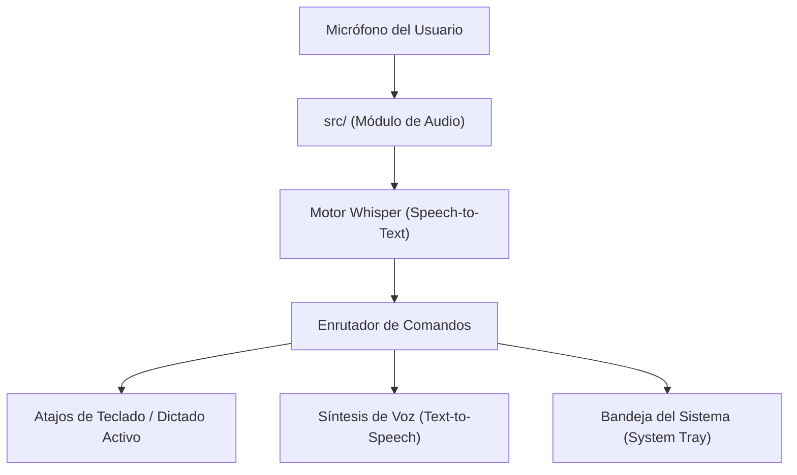

# Jarvis - Asistente de Escritorio y Control por Voz

> **Fuente original:** [`jarvis-main`](file:///C:/Users/maxgu/Documents/anonimus/jarvis-main)  
> **Rol en el ecosistema:** Aporta la interacción por voz (dictado y sintetizador de voz), atajos de teclado globales y la experiencia de asistente personal de escritorio.

---

## 1. Visión General y Propósito

A diferencia de OpenJarvis (que es un backend de orquestación pura), `jarvis-main` está diseñado para la interacción humana inmediata en el escritorio de Windows: activación por palabra clave (*wake-word*), dictado directo en cualquier ventana de texto mediante atajos de teclado globales y respuestas por voz.

---

## 2. Arquitectura Interna

### Componentes Clave:
* `src/`: Lógica de captura de buffer de audio, integración con transcriptor y despacho a la ventana activa.
* `jarvis_desktop.spec`: Configuración de empaquetado para generar ejecutables `.exe` nativos en Windows con PyInstaller.
* `EVALS.md` & `AGENTS.md`: Guías y evaluaciones de precisión de transcripción y latencia de respuesta.

---

## 3. Fortalezas y Desafíos en Hardware Liviano

* **Punto Fuerte:** Experiencia de usuario sumamente ágil: poder hablarle al asistente y que transcriba directo en Warp o en el navegador.
* **Desafío en 8 GB de RAM:** Levantar modelos locales de Whisper (como `whisper-base` o `whisper-medium`) puede ocupar entre 500 MB y 1.5 GB de VRAM/RAM.  
* **Solución Óptima:** Para el hardware AMD Ryzen 5 con 8 GB de RAM, la alternativa más eficiente es utilizar la **Web Speech API nativa del navegador** en la GUI, consumiendo exactamente 0 MB adicionales de memoria RAM en el backend de Python.

---

## 4. Integración en [[anonymous]]

1. **Módulo de Voz en Backend (`anonymous/engines/ops/voice.py`):**  
   Prepara la estructura para alternar entre reconocimiento local y web.
2. **Dictado Directo en la GUI Web (`anonymous/ui/web/app.js`):**  
   Implementa el botón de micrófono 🎙️ con la API nativa de reconocimiento de voz de Google Chrome/Edge, transcribiendo los comandos y consultas al instante sin instalar dependencias de PyTorch.

---

## 5. Enlaces Relacionados
* [[openjarvis]] - Comparación con el orquestador principal.
* [[anonymous]] - Plataforma unificada donde se integra el soporte de voz.
* [[architecture-matrix]] - Matriz comparativa.
