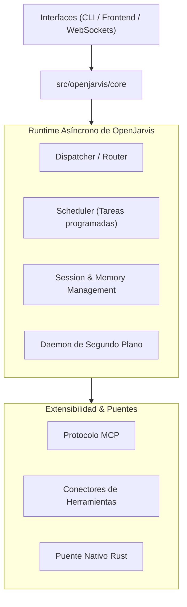

# OpenJarvis - Núcleo Orquestador y Runtime Asíncrono

> **Fuente original:** [`OpenJarvis-main`](file:///C:/Users/maxgu/Documents/anonimus/OpenJarvis-main)  
> **Rol en el ecosistema:** Proporciona la columna vertebral de despacho (*dispatcher*), ejecución asíncrona, gestión de sesiones y tareas programadas en segundo plano.

---

## 1. Visión General y Propósito

OpenJarvis es el proyecto más arquitectónicamente avanzado y extensible de la colección. Diseñado como un sistema operativo para agentes inteligentes, implementa un runtime completo con soporte para puente Rust (`_rust_bridge.py`), protocolo MCP (Model Context Protocol), conectores para múltiples canales (CLI, Web, Daemon) y persistencia distribuida.

---

## 2. Arquitectura Interna

### Componentes Clave:
* `src/openjarvis/core/`: Abstracciones centrales para el ciclo de vida del agente, eventos y despacho de mensajes.
* `src/openjarvis/daemon/`: Soporte para ejecutarse de forma silenciosa en segundo plano monitoreando el sistema o esperando tareas.
* `src/openjarvis/memory/` y `sessions/`: Almacenamiento estructurado del estado del usuario, historial y contexto conversacional.
* `src/openjarvis/scheduler/`: Motor para generar resúmenes periódicos (*briefings*) y tareas de mantenimiento preventivo.

---

## 3. Fortalezas y Complejidad

| Atributo | Evaluación | Detalle |
| :--- | :--- | :--- |
| **Modularidad** | ⭐⭐⭐⭐⭐ (Excelente) | Desacopla interfaces, cerebro, herramientas y almacenamiento. |
| **Extensibilidad** | ⭐⭐⭐⭐⭐ (Muy alta) | Soporte nativo para MCP, multi-agentes y canales externos. |
| **Sobrecarga (Overhead)** | ⭐⭐⭐☆☆ (Media) | Al ser un framework completo, incluye módulos adicionales (Rust bridge, analytics) que requieren configuración. |

---

## 4. Integración en [[anonymous]]

De OpenJarvis extrajimos la filosofía de diseño y los componentes de coordinación para construir la base de [[anonymous]]:
1. **Despachador Central (`anonymous/core/dispatcher.py`):**  
   Enruta cualquier entrada del usuario hacia el motor correcto (ofensivo, defensivo o IA general).
2. **Gestor de Sesión Persistente (`anonymous/core/session.py`):**  
   Implementación simplificada en SQLite que preserva el historial, los hallazgos y el estado del [[ptt-task-tree]].
3. **Briefing Operativo (`anonymous/engines/ops/briefing.py`):**  
   Genera informes de salud del sistema y resumen del estado de seguridad.

---

## 5. Enlaces Relacionados
* [[agent-runtimes]] - Comparativa profunda de runtimes de agentes.
* [[anonymous]] - Arquitectura del sistema donde actúa como corazón orquestador.
* [[architecture-matrix]] - Tabla comparativa global.
