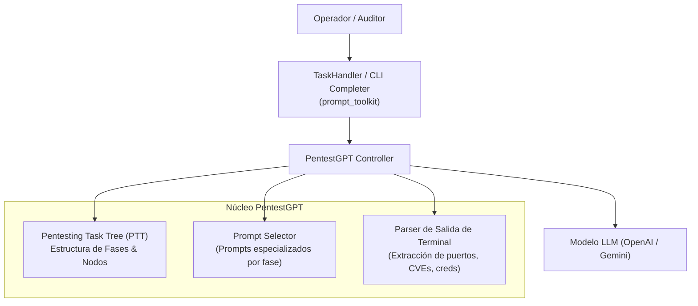

# PentestGPT - Motor de Auditoría y Pentesting Automatizado

> **Fuente original:** [`PentestGPT-main`](file:///C:/Users/maxgu/Documents/anonimus/PentestGPT-main)  
> **Rol en el ecosistema:** Aporta la lógica de pensamiento ofensivo, el árbol de tareas de penetración ([[ptt-task-tree]]) y la estrategia de evaluación de vulnerabilidades.

---

## 1. Visión General y Propósito

PentestGPT es un entorno de pruebas de penetración asistido por LLMs diseñado para automatizar las decisiones estratégicas durante un pentest. A diferencia de un escáner ciego, estructura las fases de una auditoría en un árbol jerárquico y contextualizado llamado **Pentesting Task Tree (PTT)**.

---

## 2. Arquitectura Interna

### Componentes Clave:
* `pentestgpt_legacy/utils/task_handler.py`: Interfaz de comandos interactiva con autocompletado en terminal mediante `prompt_toolkit`. Implementa comandos como `discuss`, `brainstorm`, `todo`, `next`.
* `pentestgpt_legacy/utils/pentest_gpt.py`: Controlador central que gestiona el contexto de la auditoría y mantiene la memoria del objetivo.
* `pentestgpt_agent/` & `unified_agent/`: Versiones evolucionadas del agente para soporte multi-agente.

---

## 3. El Árbol de Tareas (PTT)
El concepto más valioso de PentestGPT es el **PTT**:
1. **Reconocimiento Pasivo & Activo**: Descubrimiento de red y DNS.
2. **Escaneo y Enumeración**: Detección de puertos abiertos y servicios.
3. **Análisis de Vulnerabilidades**: Cruce de puertos con vulnerabilidades conocidas y malas configuraciones.
4. **Explotación y Post-Explotación**: Validación de vectores de ataque.
5. **Reporte y Remediación**: Generación de informes.

---

## 4. Fortalezas y Debilidades

| Dimensión | Evaluación | Observaciones |
| :--- | :--- | :--- |
| **Estrategia Ofensiva** | ⭐⭐⭐⭐⭐ (Excelente) | Su modelo mental divide las auditorías en pasos lógicos sin divagar. |
| **Consumo de Tokens** | ⭐⭐☆☆☆ (Elevado) | En su versión original pasa historiales masivos al LLM sin comprimir. |
| **Automatización Nativa** | ⭐⭐⭐☆☆ (Media) | Depende mucho de que el usuario copie y pegue manualmente la salida de la terminal. |
| **Dependencia Externa** | ⭐⭐☆☆☆ (Media/Baja) | En Linux suele depender de herramientas pesadas instaladas globalmente. |

---

## 5. Integración en [[anonymous]]

En el nuevo proyecto [[anonymous]], PentestGPT se reutiliza de forma optimizada:
1. **Motor Ofensivo Red Team**: El árbol [[ptt-task-tree]] se implementó en `anonymous/engines/red/ptt.py`, vinculado a SQLite.
2. **Automatización de Ejecución**: A diferencia del original (que requiere copiar y pegar comandos), Anonymous ejecuta automáticamente las sondas de red mediante su escáner nativo en `anonymous/engines/red/recon.py`.
3. **Filtro de Seguridad**: Se conecta directamente con [[agentshield-hitl]] para evitar ataques destructivos involuntarios.

---

## 6. Enlaces Relacionados
* [[ptt-task-tree]] - Análisis a fondo del funcionamiento del Task Tree.
* [[anonymous]] - Arquitectura completa donde se fusionó este proyecto.
* [[architecture-matrix]] - Comparativa técnica de todos los proyectos.
